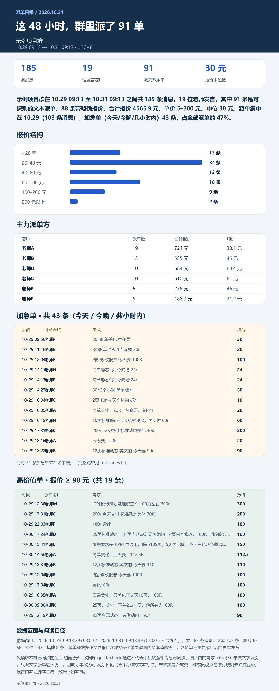
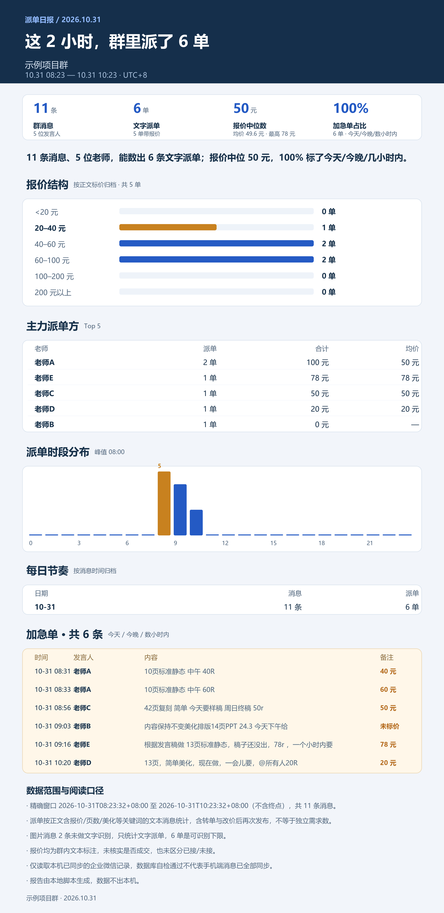
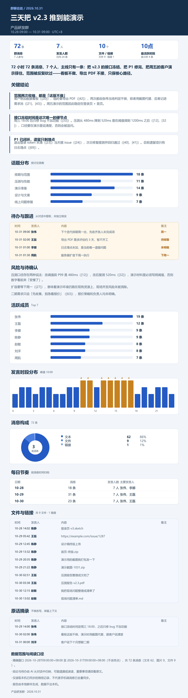

# group-chat-report · 群聊天记录日报生成器

把**微信群 / 企业微信群**的聊天记录，一键变成适合发到群里的日报：**PNG 总结长图 + 可交互 HTML 网页版**。

本项目包含两个可独立使用的 AI Skill（技能包）：

| 目录 | 对象 | 取数方式 | 运行要求 |
|---|---|---|---|
| [`wecom-group-report/`](wecom-group-report/) | 企业微信群 | 读取本机已同步的企微加密库 | Windows + 已登录企业微信，**无需**管理员权限 |
| [`wechat-group-report/`](wechat-group-report/) | 个人微信群 | 读取本机已登录微信的加密库 | Windows + 已登录微信 4.x + **管理员权限** |

两个 Skill 共用同一套分析与渲染引擎（`analyze.py` / `render_png.py` / `render_html.py` / `report-spec.md`），产出版式完全一致；仅取数层因两者的加密体系不同而各自实现。

## 效果预览

**企业微信群 · 48 小时派单群报告**（真实数据）



**企业微信群 · 2 小时小样**



**个人微信群 · 报告样式**（⚠️ 下图为虚构数据演示，仅展示版式，不代表任何真实群聊）



## 报告内容

每个报告自动产出 4 个文件：

- `report.png` — 1600px 总结长图：KPI 大字报、每日趋势、活跃榜、话题与结论
- `report.html` — 可交互网页版：可筛选、可搜索，移动端适配
- `summary.md` / `digest.md` — 文字版摘要
- `messages.json` / `facts.json` — 结构化原始数据，方便二次加工

两种分析模式（自动判别，也可手动指定）：

- **规则统计模式**：适合有明显固定消息格式的群（派单/值班/报数等），精确统计单量、金额、成员排名
- **AI 归纳模式**：适合一般工作群/项目群/兴趣群/家族群，归纳活跃度、议题、结论与待办

## 安装与使用

以 WorkBuddy 为例（其他支持 Agent Skills 的环境同样适用）：

```bash
# 1. 环境自检（在企业微信/微信已登录的状态下运行）
python wecom-group-report/scripts/check_env.py        # 企微版
python wechat-group-report/scripts/check_env.py       # 个人微信版（需管理员终端）

# 2. 一次性安装依赖（自动建虚拟环境）
python wecom-group-report/scripts/setup_env.py        # 企微版
python wechat-group-report/scripts/setup_env.py       # 个人微信版

# 3. 之后在 AI 助手里直接说：
#    "提取 XX 群最近 48 小时聊天记录，生成 PNG 总结报告"
#    "把群里今天的聊天记录做成网页版日报"
```

详细用法、参数说明见各目录内的 `SKILL.md` 与 `README.md`。

## 对外分享前请脱敏

报告默认包含成员真实昵称。两个 Skill 都自带脱敏脚本，分享报告图 / 演示数据前先跑一遍：

```bash
python scripts/anonymize_report.py --run-dir <报告目录> --prefix 老师 --group 示例项目群
```

- 成员按发言量自动编号为 `老师A / 老师B / …`（括号里的角色备注保留，数据不失真）
- 消息正文里被提到的名字一并替换，映射表写入 `alias_map.json` 供复查
- 产物输出到 `<报告目录>-anon/`，用其中的数据重新渲染即为脱敏版报告

## 目录结构

```
group-chat-report/
├── wecom-group-report/          # 企业微信版 Skill
│   ├── SKILL.md                 # 技能定义（给 AI 看的说明书）
│   ├── README.md
│   ├── scripts/                 # check_env / setup_env / extract / analyze / render
│   │   └── wxwork_reader/       # 企微取数层（密钥定位、解密、读取）
│   └── references/              # 报告规格 + 企微内部机制笔记
├── wechat-group-report/         # 个人微信版 Skill（结构与上面一致）
│   └── scripts/wxread/          # 个人微信取数层（SQLCipher 解密、内存取钥）
└── docs/                        # 效果预览图
```

## ⚠️ 免责声明 / 使用边界

- 本项目**仅支持读取当前登录账号所在群**的本地记录，**不支持**也**禁止**用于获取他人账号数据、监控他人或绕过任何访问控制。
- 聊天记录包含他人的个人信息与通信内容，生成/分享报告前请自行确认已获得群成员的合理同意，并对公开分享的内容负责。
- 取数层的实现依赖客户端本地数据的未公开格式，随版本更新可能失效；本项目仅用于个人效率工具目的的学习与交流，使用者需自行承担合规风险与使用后果。
- 详细条款见 [DISCLAIMER.md](DISCLAIMER.md)。

## License

[MIT](LICENSE)
